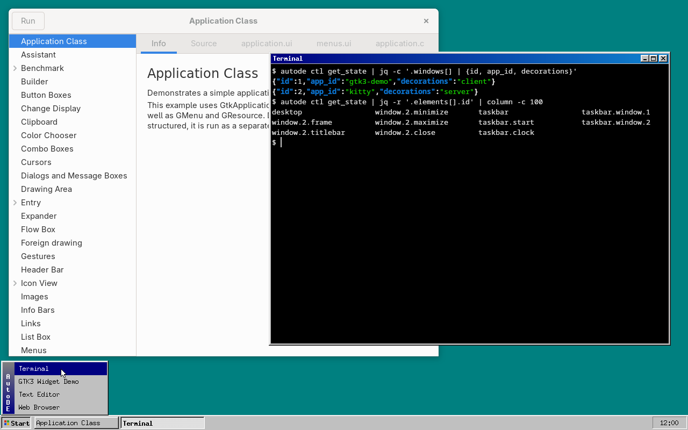
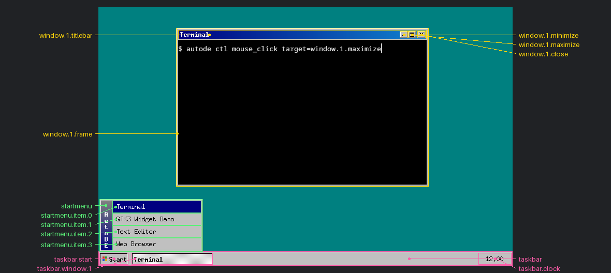

<div align="center">

# Auto DE

**A headless Wayland desktop for automated GUI testing.**
Scripts and AI agents get a mouse, a keyboard, screenshots and a structured description of
everything on screen.

[](LICENSE)




</div>

Auto DE (`autode`) is a Wayland compositor and a small Windows-95-style desktop, built for one
job: running real GUI applications under automation. It needs no display and no GPU, so it runs
the same in CI as on your machine. You drive it from a shell script with `autode ctl`, over a
JSON socket, or from an AI agent through its built-in MCP server.

## Features

- **Real apps, real toolkits.** GTK 3, Qt 6, Firefox, Chromium, kitty and Alacritty run
  natively over Wayland, including GPU clients through linux-dmabuf. See
  [compatibility](docs/COMPATIBILITY.md).
- **Deterministic screenshots.** Bitmap font, cascaded window placement, a frozen clock and no
  key repeat. The same script gives byte-identical PNGs, so golden-image tests just work.
- **Structured state.** `get_state` returns every window (id, title, app id, pid, geometry,
  focus) and every desktop widget with a stable id, so tests click `window.3.close`, not
  pixel coordinates.
- **Built-in waits.** `wait_for_window`, `wait_for_idle` (ignores blinking carets),
  `wait_for_change` and `wait_for_stable` replace `sleep` in your tests.
- **AI-agent ready.** `autode mcp` is an MCP stdio server that starts its own session. Add it
  to Claude Code or any MCP client and the agent can test your app.
- **Recording and watching.** Record a session to `.mp4` or `.webm` (ffmpeg) or `.y4m` (no
  tools needed). Use `--nested` to watch a session live in a window, or `--interactive` to
  take over the mouse and keyboard.
- **No dependencies.** One binary written in [Odin](https://odin-lang.org). The Wayland
  protocol, the rendering, PNG output and the font are all in-tree. It links only libc.

## See it work


<sub>Recorded with `autode ctl record_start` and regenerated by
[`tools/readme_images.sh`](tools/readme_images.sh).</sub>

Every widget on the desktop has a stable id and bounds in `get_state`. Pass the id as `target`
instead of coordinates:



## Quick start

You need Linux and the [Odin compiler](https://odin-lang.org/docs/install/) (`dev-2026-11` or
later) as `odin` in your `PATH`.

```sh
./build.sh                       # in a checkout: builds build/autode
export PATH=$PWD/build:$PATH     # the examples below call autode from PATH
```

### Drive it from a script

```sh
autode run --size 1280x800 --clock 12:00 &        # prints AUTODE_READY display=... control=...
autode ctl launch '{"command":["gtk3-demo"]}'
autode ctl wait_for_window title="Application Class"
autode ctl mouse_click target=window.1             # or x=200 y=150
autode ctl type_text text="hello"
autode ctl key combo=ctrl+s
autode ctl wait_for_idle quiet_ms=300
autode ctl --out shot.png screenshot
autode ctl get_state                               # windows, elements, pointer, keyboard
autode ctl quit
```

`autode ctl <method> key=value ...` sends one request and prints the JSON reply. The socket
itself speaks newline-delimited JSON, so any language can talk to it directly.

### Let an AI agent drive it

```sh
claude mcp add autode -- /path/to/auto-de/build/autode mcp --size 1280x800
```

`autode mcp` starts its own headless session and exposes tools such as `launch_app`,
`screenshot`, `get_state`, `click`, `type_text`, `press_key` and `wait_for_idle`. Add
`--nested` to watch the agent work. This repository also ships a
[Claude Code skill](.claude/skills/autode/SKILL.md) that teaches an agent the workflow.

## Documentation

| Document | Contents |
|----------|----------|
| [Usage guide](docs/USAGE.md) | Sessions, scripting, targeting, waiting, configuration, recording, MCP, CI |
| [Control API reference](docs/CONTROL.md) | Every control method, its parameters and reply; key names; element ids; MCP tools |
| [Compatibility](docs/COMPATIBILITY.md) | Tested apps and known limitations |
| [Design and architecture](docs/PLAN.md) | How it is built and why |
| [AGENTS.md](AGENTS.md) | Contributor guide: layout, constraints, build and test |

## Status

All milestones in the [plan](docs/PLAN.md) are implemented: the Wayland core, xdg-shell, the
desktop shell, input, the control socket, MCP, recording, the nested backend and GPU clients.
Not supported yet: Xwayland, multiple outputs, HiDPI and input methods. See
[known limitations](docs/COMPATIBILITY.md#known-limitations).

## Contributing

Read [AGENTS.md](AGENTS.md) first. It applies to human contributors too. In short:

```sh
./build.sh && ./build.sh test    # unit tests, golden-screenshot integration tests, MCP smoke test
```

Hard rules: no C libraries, deterministic rendering, one thread. If you change the look of the
desktop, regenerate the goldens with `UPDATE_GOLDEN=1 tests/run_integration.sh` and check every
changed image. To refresh the README images, run `tools/readme_images.sh` (needs gtk3-demo,
kitty, jq, ffmpeg and Python with Pillow).

## License

[GNU Affero General Public License v3.0](LICENSE).
