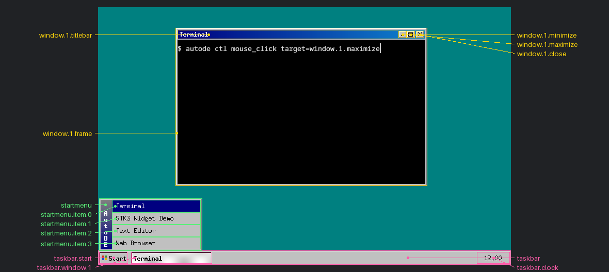

# Usage guide

This guide shows how to run Auto DE sessions and drive apps from scripts and AI agents. For
every method and its parameters, see the [control API reference](CONTROL.md).

- [Start a session](#start-a-session)
- [Send commands](#send-commands)
- [The test loop](#the-test-loop)
- [Target things on screen](#target-things-on-screen)
- [Wait instead of sleeping](#wait-instead-of-sleeping)
- [Launch apps](#launch-apps)
- [Configuration file](#configuration-file)
- [Record video](#record-video)
- [Watch or take over a session](#watch-or-take-over-a-session)
- [Use from an AI agent (MCP)](#use-from-an-ai-agent-mcp)
- [Example: a golden-screenshot test](#example-a-golden-screenshot-test)

## Start a session

```sh
autode run --size 1280x800 --clock 12:00 --quiet &
# AUTODE_READY display=autode-0 control=/run/user/1000/autode-0.ctl
```

`autode run` prints one `AUTODE_READY` line on stdout when the compositor and the control
socket are ready. Wait for that line before you send commands. Apps connect to the Wayland
display `autode-N`, and scripts connect to the control socket
`$XDG_RUNTIME_DIR/autode-N.ctl`.

| Option | Meaning |
|--------|---------|
| `--size WxH` | Screen size. Default `1280x800`, from 320x240 to 8192x8192 |
| `--clock HH:MM` | Freeze the taskbar clock, for deterministic screenshots |
| `--config FILE` | INI file with the Start menu entries and session settings (see [below](#configuration-file)) |
| `--isolate-home` | Launch every app with a fresh, empty `HOME` |
| `--nested` | Also show the session in a window on your desktop (view only) |
| `--interactive` | Like `--nested`, and forward your mouse and keyboard into the session |
| `--quiet` | Do not echo the output of launched apps to the terminal |
| `--debug` | Log all Wayland protocol traffic on stderr |
| `-- command args...` | Launch this app when the session starts |

Stop a session with `autode ctl quit`.

> [!TIP]
> To run several sessions side by side, or to keep tests away from a session you started by
> hand, give each one its own `XDG_RUNTIME_DIR`. Keep that path short: a Unix socket path must
> be shorter than 108 bytes. If it is too long, `autode run` prints `socket path too long` and
> exits without `AUTODE_READY`.
>
> ```sh
> export XDG_RUNTIME_DIR=$(mktemp -d /tmp/ade.XXXX)
> ```

## Send commands

`autode ctl` sends one request to the control socket and prints the JSON reply:

```sh
autode ctl <method> key=value ...          # simple parameters
autode ctl <method> '{"json": "object"}'   # any parameters
```

- In `key=value` form, a value that parses as JSON (`3`, `true`, `[...]`, `{...}`) is used as
  is. Anything else is sent as a string, so `title=Untitled` needs no JSON quotes.
- `--out FILE` writes a screenshot to `FILE` as a PNG, instead of printing base64.
- `--socket PATH` picks the session. Without it, `ctl` uses `$AUTODE_CTL`, or the
  lowest-numbered `$XDG_RUNTIME_DIR/autode-N.ctl` that accepts a connection.
- `ctl` prints only the `result` of the reply. If the reply is an error, it prints the error to
  stderr and exits with status 1, so `set -e` scripts stop at the first failed step.

### The socket protocol

The control socket is a Unix stream socket that speaks newline-delimited JSON. You can talk to
it from any language, without `autode ctl`:

```text
-> {"id": 1, "method": "mouse_click", "params": {"target": "taskbar.start"}}
<- {"id": 1, "result": {"x": 30, "y": 786, "window_id": 0}}
-> {"id": 2, "method": "wait_for_window", "params": {"title": "Nope", "timeout_ms": 500}}
<- {"id": 2, "error": {"message": "wait_for_window timed out", "timeout": true}}
```

One connection can send many requests. Slow requests (waits, `record_stop`, `clipboard_get`)
are answered when they finish, and other requests on other connections keep working meanwhile.

## The test loop

Every automated step follows the same pattern:

1. **Launch** an app: `autode ctl launch '{"command":["kwrite"]}'` returns `{"pid": N}`.
2. **Wait for its window**: `autode ctl wait_for_window app_id=kwrite` returns the window,
   including its `id`.
3. **Let it settle**: `autode ctl wait_for_idle quiet_ms=300`.
4. **Look**: `autode ctl --out shot.png screenshot`, or `autode ctl get_state` for exact
   geometry and ids.
5. **Act**: `mouse_click`, `type_text`, `key`, `scroll`, `mouse_drag`.
6. **Wait again**, then check the result with a screenshot or `get_state`.

Apps redraw asynchronously. Always wait after a launch, a click or typing, before you look.

## Target things on screen

Coordinates are full-screen pixels, with the origin at the top left. Two ways avoid hard-coded
coordinates:

- **Element ids.** Every desktop widget has a stable id in `get_state.elements`. Pass it as
  `target` to `mouse_move`, `mouse_click`, `mouse_down`, `mouse_up` or `scroll`:

  ```sh
  autode ctl mouse_click target=taskbar.start
  autode ctl mouse_click target=startmenu.item.0
  autode ctl mouse_click target=window.3.close
  ```

  

  The full list of ids is in the [reference](CONTROL.md#element-ids).

- **`window.<id>`** targets the center of a window's content, or its first visible point if
  something covers the center.

To click inside an app, add an offset to the window's `content` rectangle from `get_state`.
Take a screenshot of the window (`screenshot window_id=3`) to find the offset.

Apps that draw their own title bar (GTK header bars, Firefox) show `"decorations": "client"`
in `get_state` and have no `window.<id>.*` elements. Use `minimize`, `maximize`, `close`,
`move` and `resize` with their `window_id`, or drag the app's own header bar with `mouse_drag`.

**Scaled and cropped screenshots.** `screenshot` accepts `scale` (for example `0.5`),
`window_id` or `region`. Its reply gives the `x`, `y` and `scale` of the image, so a point in
the image maps back to the screen like this:

```text
screen_x = x + image_x / scale
screen_y = y + image_y / scale
```

## Wait instead of sleeping

| Wait | Returns when | Use it |
|------|--------------|--------|
| `wait_for_window {title?, app_id?, match?}` | A mapped window matches (`contains`, `exact` or `regex`) | After `launch`, or after an action that opens a dialog |
| `wait_for_idle {quiet_ms?}` | No app has visibly changed for `quiet_ms` | After typing or clicking. Ignores identical repaints and blinking carets |
| `wait_for_change {window_id? \| region?}` | Pixels differ from when you called it | When you expect a specific area to update |
| `wait_for_stable {window_id? \| region?, quiet_ms?}` | Pixels have not changed for `quiet_ms` | Before a golden screenshot of one area |

All waits take `timeout_ms` (default 10000). On timeout they reply with an error that contains
`"timeout": true`. `wait_for_idle strict=true` counts every redraw, and `wait_for_stable` sees
carets, so give it a region without one. See
[known limitations](COMPATIBILITY.md#known-limitations).

## Launch apps

```sh
autode ctl launch '{"command":["firefox","--new-instance","about:blank"],"isolate_home":true}'
autode ctl launch '{"command":["./myapp"],"cwd":"/src/myapp","env":{"MYAPP_DEBUG":"1"}}'
```

- `command` is an argv array. (The MCP tool `launch_app` also accepts a string.)
- Apps get `WAYLAND_DISPLAY` and the toolkit variables that make them use Wayland
  (`GDK_BACKEND`, `QT_QPA_PLATFORM`, `SDL_VIDEODRIVER`, `MOZ_ENABLE_WAYLAND`, ...). `DISPLAY`
  is removed, because there is no Xwayland.
- `isolate_home: true` (or `autode run --isolate-home`) gives the app a fresh, empty `HOME`, so
  your own settings, profiles and recent files never leak into a test. The reply contains the
  `home` directory it used.
- `processes` lists launched apps. `app_output {pid}` returns their captured stdout and stderr.
  `kill {pid}` sends SIGTERM to the app's process group.

## Configuration file

```ini
[session]
clock = 12:00              ; freeze the clock for deterministic screenshots

[app.1-terminal]           ; Start menu entries, sorted by section name
name = Terminal
exec = alacritty --option value

[app.2-editor]
name = Text Editor
exec = kwrite
```

Pass it with `autode run --config autode.ini`. `exec` is split on whitespace and honors
`'...'` and `"..."` quoting. Without a config, the Start menu lists common apps found in
`PATH`.

## Record video

```sh
autode ctl record_start path=run.mp4 fps=30        # .mp4 .webm .mkv .mov use ffmpeg
autode ctl record_start path=run.y4m               # .y4m needs no external tools
autode ctl record_start path=win.mp4 window_id=3   # follow one window
autode ctl record_stop                             # {"path", "frames", "dropped", "duration_ms"}
```

`region={"x":0,"y":0,"width":640,"height":480}` records part of the screen. The pointer is
drawn into the video unless you pass `include_cursor=false`. ffmpeg is started as a child
process only while recording. It is never linked.

## Watch or take over a session

```sh
autode run --nested           # show the session in a window on your desktop
autode run --interactive      # ...and forward your mouse and keyboard into it
autode mcp --nested           # watch an AI agent work
```

The nested window is a normal Wayland client of your desktop. The session keeps its own size
and stays deterministic. The window only shows it.

## Use from an AI agent (MCP)

```sh
claude mcp add autode -- /path/to/auto-de/build/autode mcp --size 1280x800
```

`autode mcp` is an MCP server on stdio. It starts its own headless session (and stops it on
exit), so the agent needs nothing else running. It accepts the session options `--size`,
`--config`, `--clock`, `--isolate-home` and `--nested`. To share a session with a script, start
`autode run` yourself and pass `--attach <control socket>`.

Each MCP tool call becomes one control request. The tool names and their mapping to control
methods are in the [reference](CONTROL.md#mcp-tools). The server sends instructions that
explain the workflow, coordinates and element ids to the agent. For Claude Code, the
[autode skill](../.claude/skills/autode/SKILL.md) in this repository adds detailed guidance.

## Example: a golden-screenshot test

A complete test script, suitable for CI. It needs no display and no GPU.

```sh
#!/usr/bin/env bash
set -euo pipefail
export XDG_RUNTIME_DIR=$(mktemp -d /tmp/ade.XXXX)
trap 'autode ctl quit >/dev/null 2>&1 || true; rm -rf "$XDG_RUNTIME_DIR"' EXIT

autode run --size 1024x768 --clock 12:00 --isolate-home --quiet > "$XDG_RUNTIME_DIR/out" &
until grep -q AUTODE_READY "$XDG_RUNTIME_DIR/out" 2>/dev/null; do sleep 0.1; done

autode ctl launch '{"command":["./build/myapp"]}' >/dev/null
win=$(autode ctl wait_for_window app_id=myapp | jq .id)
autode ctl mouse_click target="window.$win" >/dev/null
autode ctl type_text text="hello" >/dev/null
autode ctl wait_for_idle quiet_ms=300 >/dev/null
autode ctl --out actual.png screenshot window_id="$win" >/dev/null

cmp actual.png tests/golden/myapp_hello.png
```

Screenshots of Auto DE's own desktop are byte-identical between runs. Your app's pixels are
deterministic only if the app is, so pin its fonts, theme and data, and use `isolate_home`.
The [integration tests](../tests/run_integration.sh) of this repository follow the same pattern.
